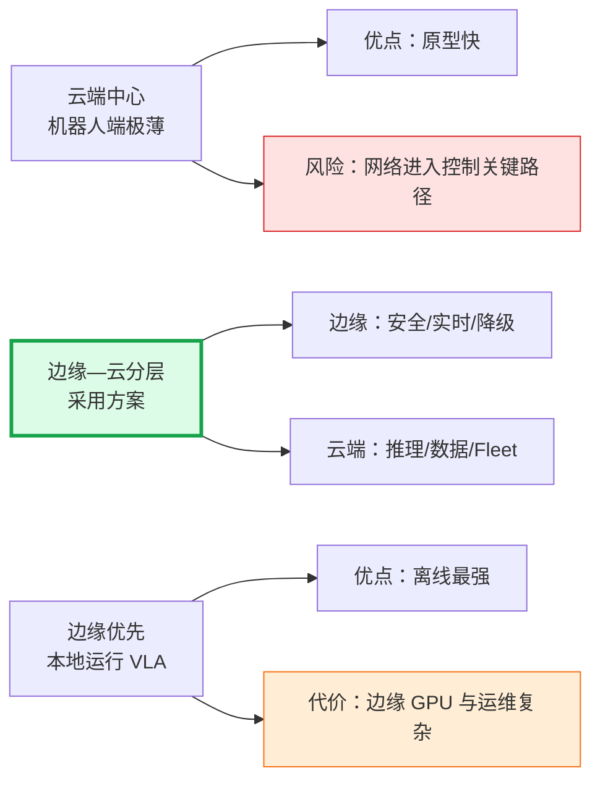
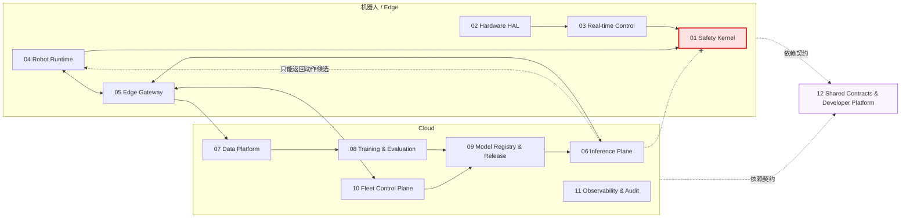
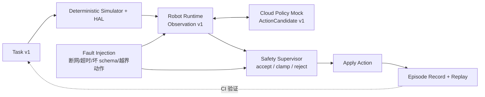
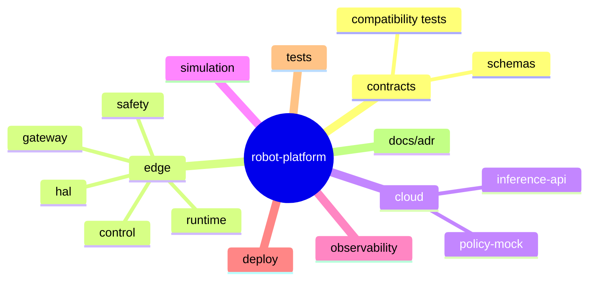
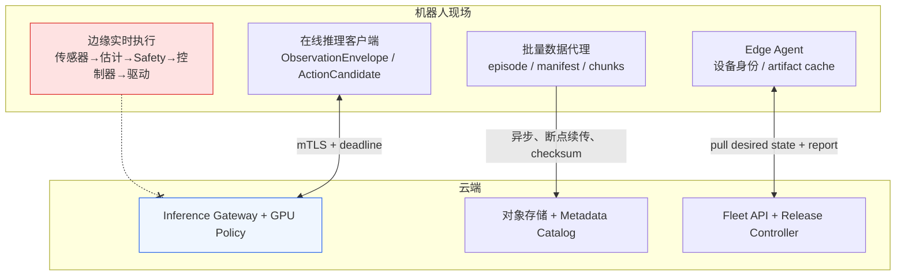
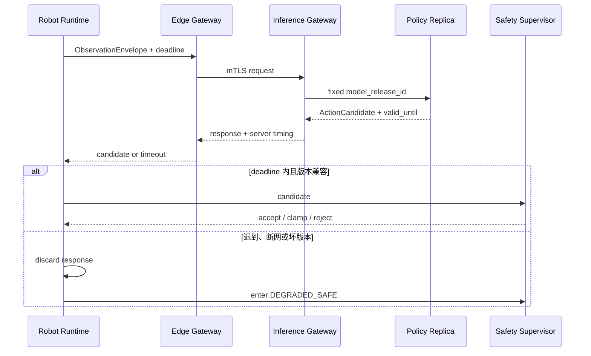
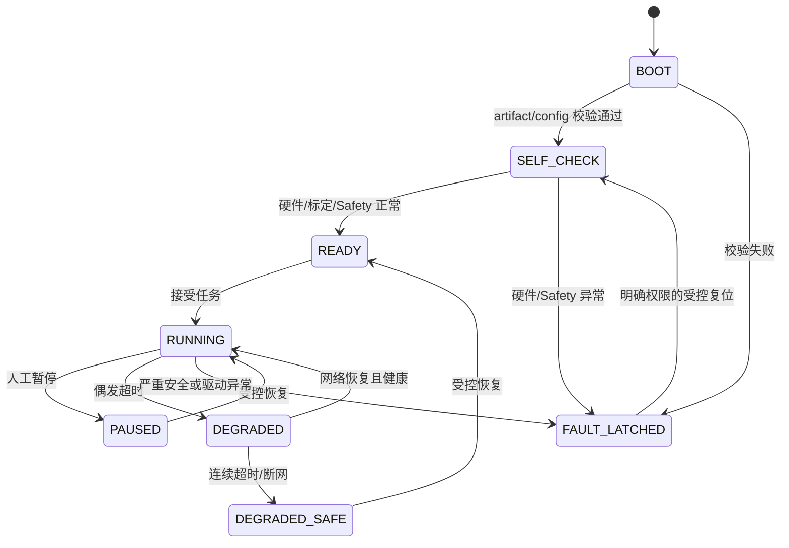
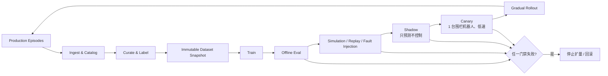
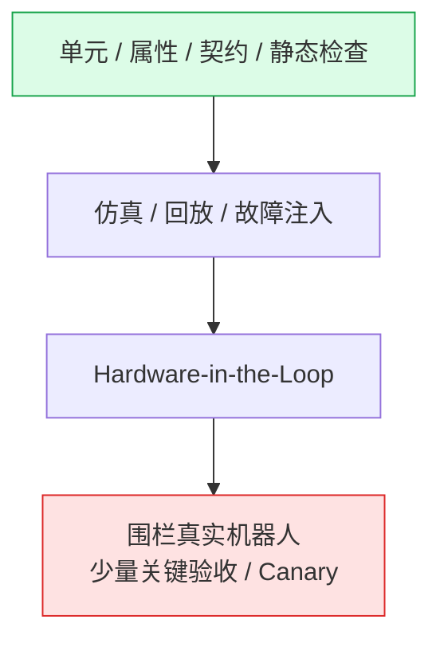
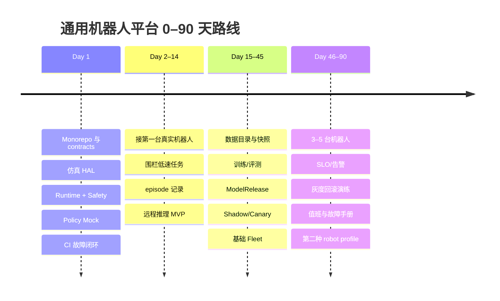

# 机器人公司 Day 1 飞书调研报告 Implementation Plan

> **For agentic workers:** REQUIRED SUB-SKILL: Use superpowers:subagent-driven-development (recommended) or superpowers:executing-plans to implement this plan task-by-task. Steps use checkbox (`- [ ]`) syntax for tracking.

**Goal:** 创建并核验一篇以 10 张框图、流程图和状态图为核心的飞书调研报告，完整呈现通用机器人公司的 Day 1 基础设施设计。

**Architecture:** 先在飞书“我的空间”创建包含固定章节标题的文档骨架，获取各章节 block ID；再用 XML `block_insert_after` 向每个章节插入 Mermaid 画板和关键词解释。最后回读文档目录与全文，核验章节、画板数量、关键术语、来源链接和标题。

**Tech Stack:** `lark-cli docs`、飞书 Docx XML、Mermaid whiteboard、Python/JSON 只读校验、openpi 本地源码与文档

---

### Task 1: 飞书能力、身份与输入预检

**Files:**
- Read: `docs/superpowers/specs/2026-07-16-robotics-company-day1-infrastructure-design.md`
- Read: `/home/zky-miakho/.agents/skills/lark-shared/SKILL.md`
- Read: `/home/zky-miakho/.agents/skills/lark-doc/SKILL.md`
- Read: `/home/zky-miakho/.agents/skills/lark-doc/references/lark-doc-xml.md`
- Read: `/home/zky-miakho/.agents/skills/lark-doc/references/style/lark-doc-style.md`
- Read: `/home/zky-miakho/.agents/skills/lark-doc/references/style/lark-doc-create-workflow.md`
- Read: `/home/zky-miakho/.agents/skills/lark-doc/references/lark-doc-create.md`
- Read: `/home/zky-miakho/.agents/skills/lark-doc/references/lark-doc-fetch.md`
- Read: `/home/zky-miakho/.agents/skills/lark-doc/references/lark-doc-update.md`
- Read: `/home/zky-miakho/.agents/skills/lark-doc/references/style/lark-doc-update-workflow.md`

- [ ] **Step 1: 核验书面设计完整性**

Run: `rg -n '^## ' docs/superpowers/specs/2026-07-16-robotics-company-day1-infrastructure-design.md`

Expected: 包含目标、约束、方案、原则、模块、四平面、契约、状态机、闭环、Monorepo、CI、安全、路线、报告设计、依据和验收标准。

- [ ] **Step 2: 检查飞书用户身份**

Run: `LARKSUITE_CLI_NO_UPDATE_NOTIFIER=1 LARKSUITE_CLI_NO_SKILLS_NOTIFIER=1 lark-cli auth status --json --verify`

Expected: 当前用户身份 verified，Docs 创建、更新和读取权限可用；若缺 scope，按错误返回的最小 scope 走 split-flow 授权。

### Task 2: 创建飞书报告骨架

**Files:**
- Create: `/tmp/robotics-company-day1-feishu/report-manifest.json`

- [ ] **Step 1: 使用 XML 创建文档骨架**

创建标题为 `机器人公司 Day 1 基础设施：从 openpi 到可生产通用平台` 的文档，正文骨架固定为：

```xml
<title>机器人公司 Day 1 基础设施：从 openpi 到可生产通用平台</title>
<callout emoji="🎯" background-color="light-blue">
  <p>适用范围：3–10 人团队、1–5 台机器人、机器人形态未定；边缘安全持续运行，云端提供低频策略推理。</p>
</callout>
<h1>执行摘要</h1>
<h1>1. 约束、方案与架构决策</h1>
<h1>2. 边缘—云总体模块架构</h1>
<h1>3. Day 1 最薄垂直切片</h1>
<h1>4. 四平面数据传输</h1>
<h1>5. 在线推理请求时序</h1>
<h1>6. 生产运行状态机</h1>
<h1>7. 数据—模型—生产闭环</h1>
<h1>8. CI、测试与可观测性</h1>
<h1>9. 0–90 天路线图</h1>
<h1>10. 风险、术语与来源</h1>
```

Run: `lark-cli docs +create --as user --content -`

通过 stdin 传入 XML。Expected: 返回唯一 `document_id` 和 URL，warnings 为空或仅包含不影响正文的降级说明。

- [ ] **Step 2: 保存报告清单**

把 `document_id`、URL、标题和预期画板数 `10` 写入 `/tmp/robotics-company-day1-feishu/report-manifest.json`，不得保存 access token。

### Task 3: 获取章节 block ID

**Files:**
- Modify: `/tmp/robotics-company-day1-feishu/report-manifest.json`

- [ ] **Step 1: 获取目录与 block ID**

Run:

```bash
lark-cli docs +fetch --as user \
  --doc "$document_id" \
  --scope outline \
  --max-depth 1 \
  --detail with-ids
```

Expected: 返回 11 个一级标题及各自 block ID。

- [ ] **Step 2: 将标题映射写入清单**

保存以下稳定键到 block ID 的映射：

```text
summary
decision
architecture
day1
transport
inference
state_machine
ml_loop
quality
roadmap
risks_terms_sources
```

Expected: 11 个键均有唯一非空 block ID。

### Task 4: 写入执行摘要

**Files:**
- Read: `/tmp/robotics-company-day1-feishu/report-manifest.json`

- [ ] **Step 1: 在“执行摘要”后插入结论**

内容必须包含：

- 采用边缘—云分层；
- Safety Kernel、实时控制和最终动作裁决留在边缘；
- 云端只返回 ActionCandidate；
- Day 1 验收是仿真 + Policy Mock + Safety + CI 故障闭环；
- 不在 Day 1 建 Kubernetes、完整数据湖、真实 OTA 或真实 VLA serving；
- 生产化的判断标准是可验证、可诊断、可回滚，而不是“机器人能动”。

Run:

```bash
lark-cli docs +update --as user --doc "$document_id" \
  --command block_insert_after --block-id "$summary_block_id" --content -
```

Expected: 更新结果 success。

### Task 5: 写入方案比较与决策图

**Files:**
- Read: `docs/superpowers/specs/2026-07-16-robotics-company-day1-infrastructure-design.md`

- [ ] **Step 1: 插入三种方案比较 Mermaid 画板**



画板后写入已确认约束和采用 B 的理由，并解释 Edge、Cloud、Safety、ActionCandidate。

Expected: 更新 result=success，返回一个 whiteboard new block。

### Task 6: 写入总体模块架构图

- [ ] **Step 1: 插入边缘—云模块框图**



图后按 12 个模块分别列出职责、输入输出、禁止依赖和早期 owner 原则。

Expected: 图中明确表示 Cloud 不能绕过 Safety Kernel。

### Task 7: 写入 Day 1 闭环与 Monorepo 图

- [ ] **Step 1: 插入 Day 1 最薄垂直切片**



- [ ] **Step 2: 插入 Monorepo 模块树**



图后写入 Day 1 必须完成和明确不做清单。

Expected: 本章节新增 2 个 whiteboard。

### Task 8: 写入四平面传输图

- [ ] **Step 1: 插入四平面架构图**



图后解释四个“平面”、mTLS、deadline、manifest、checksum、对象存储和 desired/reported state。

Expected: 正文明确纠正“三平面”为“四平面”。

### Task 9: 写入在线推理时序图

- [ ] **Step 1: 插入 sequence diagram**



图后解释 monotonic clock、request_id、episode_id、valid_until、action chunk、clamp/reject 和迟到响应。

Expected: 云端响应不会直接到驱动。

### Task 10: 写入生产状态机图

- [ ] **Step 1: 插入 state diagram**



图后解释 watchdog、safe stop、故障锁存和为什么网络恢复不能自动解除 FAULT_LATCHED。

### Task 11: 写入数据—模型—生产闭环图

- [ ] **Step 1: 插入发布闭环**



图后定义 ModelRelease 的完整字段，并解释 Shadow、Canary、dataset snapshot、data lineage、P95/P99 和四类门禁指标。

### Task 12: 写入 CI、测试与可观测性图

- [ ] **Step 1: 插入测试金字塔**



图后写入 CI 自动步骤，并用表格解释 Logs、Metrics、Traces、Episode Record、Safety Event 和共同关联 ID。

Expected: 强调真实机器人测试不能替代下层自动化测试。

### Task 13: 写入 0–90 天路线图

- [ ] **Step 1: 插入时间线**



图后写入每阶段验收证据、owner 建议和升级条件。

### Task 14: 写入风险、术语和来源

- [ ] **Step 1: 写入风险清单**

必须包含：

- 把云端推理误放进实时/安全关键路径；
- Observation/Action 单位或坐标系漂移；
- 权重与 config/transforms/norm stats 混用；
- 日志上传阻塞控制；
- 机器人自动解除锁存故障；
- 过早引入 Kubernetes、多云和完整平台；
- Safety owner 与模型发布权限未分离；
- 只看平均延迟而忽略 P95/P99。

- [ ] **Step 2: 写入术语表**

至少解释：CI、Edge、HAL、Safety Supervisor、watchdog、safe stop、ObservationEnvelope、ActionCandidate、action chunk、deadline、monotonic clock、mTLS、WebSocket、gRPC、QUIC、manifest、checksum、object storage、Fleet、Edge Agent、desired/reported state、OTA、rollout、rollback、Shadow、Canary、ModelRelease、P95/P99、Logs/Metrics/Traces、FAULT_LATCHED。

- [ ] **Step 3: 写入来源**

写入并链接：

- `https://github.com/Physical-Intelligence/openpi`
- openpi `docs/remote_inference.md` 和 WebSocket server/client 源码链接；
- `https://docs.ros.org/en/rolling/Tutorials/Demos/Real-Time-Programming.html`
- `https://www.iso.org/standard/73933.html`
- `https://www.iso.org/standard/62996.html`

将 OpenTelemetry、SLSA、TUF/Uptane、MCAP 标记为“后续技术选型参考”，不描述为本次已完整核实的事实依据。

### Task 15: 远端回读与图表核验

**Files:**
- Create: `/tmp/robotics-company-day1-feishu/fetched.xml`
- Create: `/tmp/robotics-company-day1-feishu/verification.json`

- [ ] **Step 1: 回读目录**

Run:

```bash
lark-cli docs +fetch --as user --doc "$document_id" \
  --scope outline --max-depth 2 --detail with-ids
```

Expected: 11 个一级章节均存在且顺序正确。

- [ ] **Step 2: 回读全文**

Run:

```bash
lark-cli docs +fetch --as user --doc "$document_id" --detail full
```

Expected: XML 中有 10 个 `<whiteboard token=`；正文包含 `Safety Kernel`、`ObservationEnvelope`、`ActionCandidate`、`ModelRelease`、`FAULT_LATCHED`、`CI` 和 `四平面`。

- [ ] **Step 3: 校验来源和降级**

Expected: openpi、ROS 2、ISO 10218 和 ISO/TS 15066 链接均存在；写入结果没有 failed/partial_success；若 Mermaid 出现降级 warning，定位对应章节并重新写入简化 Mermaid。

- [ ] **Step 4: 返回交付结果**

向用户提供文档 URL、画板数量 `10`、回读结果和任何已知表达降级。不得只凭写入返回值宣称完成。
